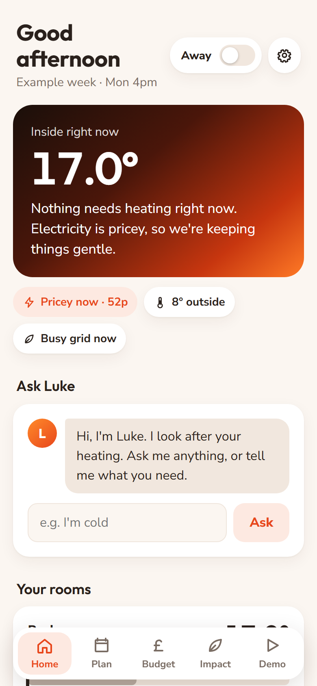
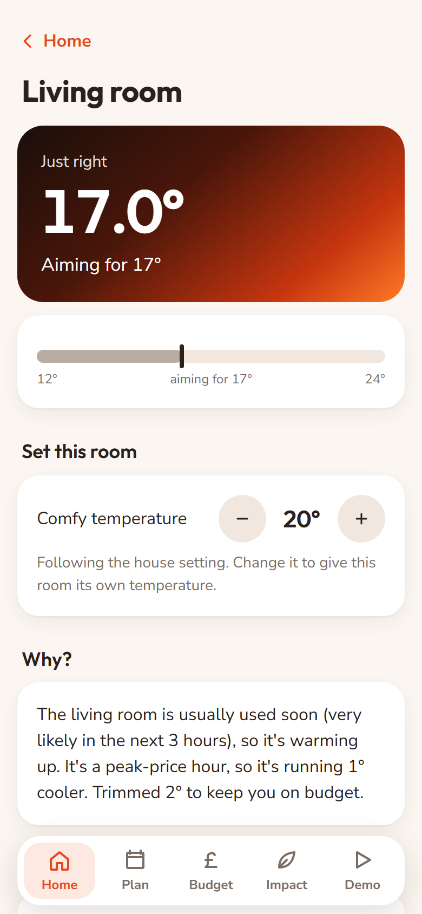
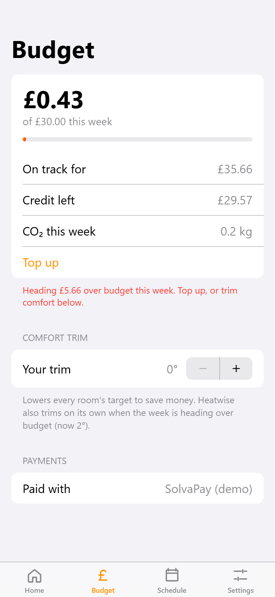

# Heatwise

**An AI agent that buys your heating for you.** It learns who uses which room and when, heats only those rooms, does it at the cheapest and cleanest hours of the day, and pays for every kWh itself through SolvaPay. It never spends past the budget you loaded without asking.

Built for Hack for Impact (Imperial College London, 21 Nov 2026): AI + payments + a sustainable angle.

> **Status: toy version / MVP.** Everything runs on a simulated house and simulated people. Prices, grid carbon and weather are real (live or a saved snapshot). The numbers show the idea works; they are not what a real home would save.

## Results (toy run, 1 week, 3 rooms)

| | Cost | CO₂ | Comfort |
|---|---|---|---|
| Old-style timer | £46.94 | 26.6 kg | 69.8% |
| **Heatwise** | **£42.99** | **25.0 kg** | **96.4%** |

That's **8.4% cheaper with 6.3% less CO₂, and people are comfortable far more of the time** (21°C in rooms in use, 18°C bedroom overnight; offline signals snapshot, `python -m heatwise.run_toy --offline`). With a £40 weekly budget, the agent trims comfort by up to 2° and finishes at £39.56.

The occupancy model (routine plus live motion) predicts room use better than the routine heatmap alone: Brier score **0.021 vs 0.029**.

## How it works

1. **Learn routines.** Motion sensors and phones give a noisy view of who is home and where. A routine heatmap gives a prior, and a logistic regression corrects it with live sensor signals to predict *"will this room be used in the next 3 hours?"*
2. **Decide targets.** Rooms in use, or about to be, are heated to comfort (21°C, or 18°C for the bedroom overnight). Other rooms hold eco (17°C), or 12°C when nobody's home. That 12° safety floor is never overridden.
3. **Be price- and carbon-aware.** Each half-hour gets a score: price plus a carbon cost. In the best quarter of the day, rooms likely to be used get pre-heated by 1°. In the worst quarter, occupied rooms coast 1° lower.
4. **Pay for it.** The agent buys energy in 10p blocks from a supplier behind a paywall. The human loads the budget once through checkout, and the agent spends within it. If the month is heading over budget, it trims comfort gradually. If credit runs out, it keeps safety heating on from emergency credit and raises a top-up request with a checkout link.

See [docs/ARCHITECTURE.md](docs/ARCHITECTURE.md) for the modules and data flow, and [docs/DECISIONS.md](docs/DECISIONS.md) for **every choice made and why**.

## Quickstart

Needs Python 3.11+.

```bash
python -m venv .venv
# Windows: .venv\Scripts\activate    macOS/Linux: source .venv/bin/activate
pip install -r requirements.txt

python -m heatwise.run_toy             # full toy run (live prices if online), £40 budget
python -m heatwise.run_toy --offline   # use the saved price/carbon snapshot
python -m heatwise.run_toy --budget 3  # see the agent run out of credit and ask for a top-up

python -m http.server -d web 8000      # then open http://localhost:8000
                                       # "The house, step by step": press Play to watch both houses through the week
```

Other entry points:

```bash
python -m heatwise.occupancy   # train and score the occupancy model vs the heatmap
python -m heatwise.signals     # fetch today's live signals and save them as the offline snapshot
pytest                         # all tests (offline, no keys needed)
```

## Screenshots

<p>



</p>

More in [docs/screenshots](docs/screenshots) (dark mode, Schedule, Settings). Regenerate with `python tools/screenshots.py` while the app is running.

## Demo script (2 minutes)

Start the app (`uvicorn heatwise.app:app --port 8010`) and open http://127.0.0.1:8010.

1. **Demo tab (or the Simulation panel on a laptop screen):** the house drawing shows Alex and Sam in their rooms, and **The routine / Today, step by step** shows their timetable next to what Heatwise did (✓ = the room was warm when they arrived). Show this week's calendar (gym, working from home, a trip, friends over). Add one, e.g. "Friends over, Sat 7pm".
2. **Budget → Your limits:** set a **daily limit** of £3 or £4.
3. **Demo → Play the week.** Read out Luke's notes: rooms warming before people get home, heat bought each hour, the trip putting the house on away.
4. When the daily limit is hit, Luke asks **"Allow £2 more?"** (on Home and Budget). Tap **Allow**: that's the SolvaPay approval moment.
5. **Jump to Thu** and open the living room: the line chart dips while you're away and warms before you're back.
6. **Impact tab:** "£5 saved, 2 kg less CO₂ (like not driving 12 km)", against an ordinary timer.
7. **Home → Ask Luke:** "I'm cold" → Luke proposes a warmer temperature → **Yes, do it**.
8. **Repairs (the "never think about heating" moment):** Simulation panel → **Break something → Break living room**, then keep playing. Within about 2 hours of house time Luke notices the room is warming too slowly and offers an engineer on Home ("Book engineer · £85"). Tap it: it's paid from the repairs allowance, the engineer comes in working hours, and Luke confirms the fix. **Luke's week** on Home sums it up. (The engineer and repair payment are simulated.)

## Using the app

The household app is a phone-first web app in a warm, friendly style: plain-English labels, visuals you can read at a glance (temperature bars, a budget ring, 24-hour heating strips), light and dark mode, and large-text support:

```bash
uvicorn heatwise.app:app --host 127.0.0.1 --port 8000
# open http://127.0.0.1:8000 (best at phone width)
```

Five tabs (Home, Plan, Budget, Impact, Demo) plus Settings behind the gear on Home:

- **Luke looks after the heating for you:** you set the money and the rules (Budget → **Your rules for Luke**: weekly money, daily limit, temperatures, never-below floor, repairs allowance). He heats, buys the energy, sticks to the budget, spots faulty radiators and books repairs with your approval, and sums up **Luke's week** on Home.

- **Luke** (Ask Luke, on Home): type “I'm cold”, “make the living room 22”, “I'm going away” or “why is the bedroom cold?”. He answers, or asks “Shall I…?” with a change you confirm with one tap (away, the house temperature, one room's temperature, or the budget trim). Nothing changes until you tap Yes. Uses Claude if `ANTHROPIC_API_KEY` is set (in `.env`), built-in rules otherwise.
- **Live temperatures:** in live mode the room temperatures move within seconds of a change, not just on the quarter-hour (see DECISIONS D20).

- **Home:** the Away switch (every room to 12°C), each room's temperature and status, and the price, outside temperature and grid carbon right now. Tap a room to see its target, **why** it's at that target, and a chart of the next 24 hours.
- **Budget:** spent this week against your budget, the projection, credit left and CO₂. **Top up** (£5, £10 or £20 through SolvaPay) and a comfort trim stepper.
- **Plan:** which rooms heat when over the next 24 hours, the cheapest hours, and calendar events with what each one does to the heating.
- **Settings:** Appearance (System, Light or Dark), connect Google Calendar (secret iCal link), the daytime comfort temperature, and a **Demo** section to move the simulated week along (the home starts on Monday at 16:00).

Design review helpers: add `?theme=dark`, `?theme=light` or `?text=xl` (largest text size) to the URL.

Configuration, all optional, in `.env` (see `.env.example`):

| Variable | What it does |
|---|---|
| `HEATWISE_BUDGET` | Weekly budget loaded in the demo (default £45: a typical week at 21° costs about £41, so there is no budget trim until you tighten it. Set a daily limit in Budget → Your limits to show the approval moment) |
| `HEATWISE_ICAL_URL` | Your Google Calendar's **secret address in iCal format** (Google Calendar → Settings → your calendar → Integrate calendar). Events with "away/trip/flight/holiday", "WFH" or "guests/friends over" adjust the heating. Without it, a demo week is used. **Treat it like a password.** |
| `SOLVAPAY_SECRET_KEY`, `SOLVAPAY_PRODUCT_REF` | Real SolvaPay sandbox payments (see below) |

## Running against the SolvaPay sandbox

By default the agent pays a **local stand-in supplier** that behaves like the SolvaPay paywall (402 plus a checkout link). To use real SolvaPay sandbox payments:

1. Create a SolvaPay sandbox account and a product. Give it a plan where **1 unit = 10p** (one energy block).
2. Copy `.env.example` to `.env` and fill in `SOLVAPAY_SECRET_KEY` (an `sk_sandbox_...` key) and `SOLVAPAY_PRODUCT_REF`.
3. Run `python -m heatwise.run_toy`. The first purchase returns a checkout URL. Pay it in the browser with Stripe's test card, then run again.

The SolvaPay path is not covered by the automated tests because it needs a live sandbox account. Test it by hand before the demo.

## Project layout

```
app/index.html   the household app page (served by heatwise/app.py)
heatwise/
  app.py         FastAPI app: home state, Boost, away, trim, top-up, demo clock
  live.py        a running household: engine + clock + overrides + calendar + wallet
  calendar.py    secret iCal link -> events -> away / WFH / guests hints; demo week
  sim.py         simulated house: rooms (RC thermal model), people, noisy sensors
  occupancy.py   routine heatmap + live-sensor model, Brier/AUC evaluation
  signals.py     Octopus Agile prices, grid carbon, weather; offline fallbacks
  controller.py  per-room targets, timer baseline, budget trim
  supplier.py    energy supplier behind a paywall (local or SolvaPay)
  wallet.py      agent pays per step, buys blocks, emergency credit, top-up requests
  compare.py     run a week, score cost / CO2 / comfort
  run_toy.py     the end-to-end toy run; writes web/data.json
web/             analyst results page for judges (index.html + generated data.json)
data/            saved signals snapshot for offline runs
tests/           pytest suite (offline)
docs/            ARCHITECTURE.md, DECISIONS.md
heatwise-idea.md the original idea write-up
```

## Security and privacy

This repo is written to be safe to make public.

- **No secrets in git.** Keys are read from the environment or `.env`, which is git-ignored. `.env.example` contains names only.
- **No personal data.** Every household, person (`alex`, `sam`) and sensor reading is simulated. The only real data is public market and weather data.
- **Privacy by design for the real product.** Motion data reveals when people are home, so the plan is to keep it on the local network and never send it to the cloud (see `heatwise-idea.md`).
- **Fails safe.** The controller never sets a room below 12°C, and losing payment, Wi-Fi or a data feed never switches heating off (emergency credit, then a snapshot, then synthetic data).
- **Calendar link is a secret.** It's only read from `.env`, must be https, and never appears in logs, errors or API responses (tests check this). Only derived hints are kept, in memory.
- **Validated input.** The app API checks room names, Boost hours (0.25 to 6), trim (0 to 3°) and top-ups (up to £200), and its docs/OpenAPI pages are off. The supplier API checks `customer_ref` against `[A-Za-z0-9_-]{1,64}`, caps top-ups at £500, and has its docs pages turned off. Run servers on `127.0.0.1` unless you mean to expose them.
- **Minimal third-party code in the browser.** One pinned Chart.js file from cdnjs. No trackers or cookies.
- The event deck (`*.pptx`) is git-ignored and not redistributed.

If you find a security issue, open a private GitHub security advisory on this repo rather than a public issue.

## What's next

- Real sensors: one ESP32 motion and temperature sensor in one room for 2 weeks, logged to Home Assistant, then rerun the occupancy evaluation on real data.
- More rooms and people, heat flowing between rooms, a recorded week of real prices.
- The LLM layer (next round): plain-English commands ("WFH Tuesday") as confirm cards, reading messy calendar titles, "why?" answers and budget tips in natural language. The engine keeps making every decision.
